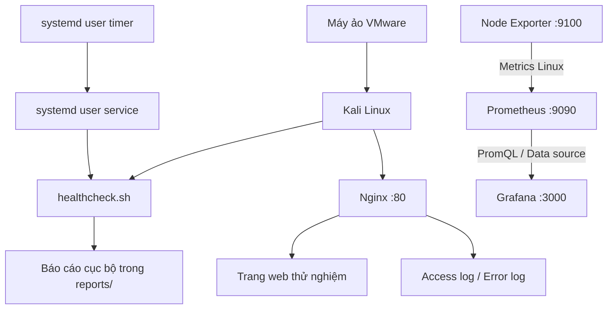
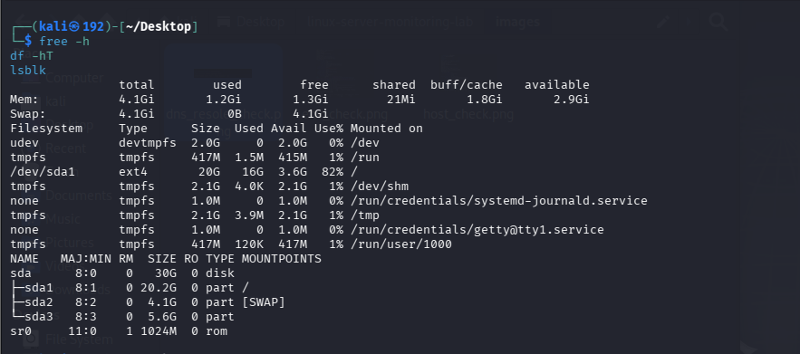
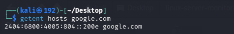
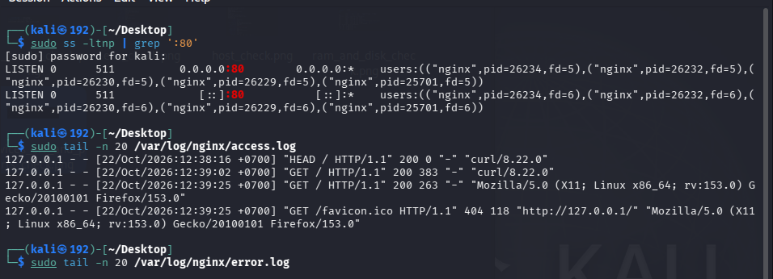
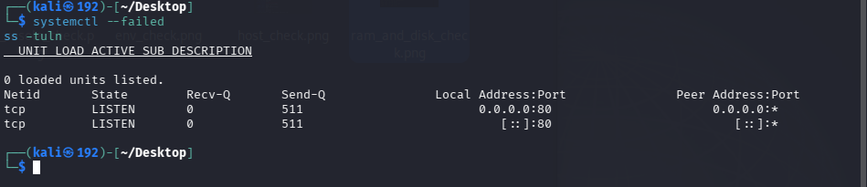
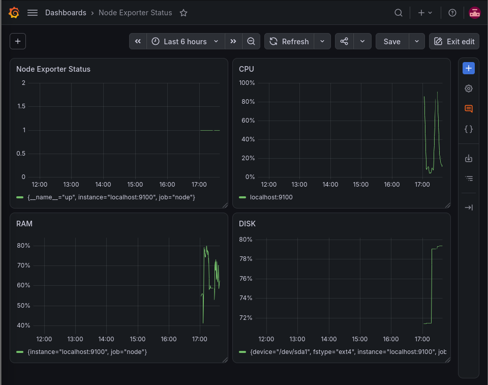
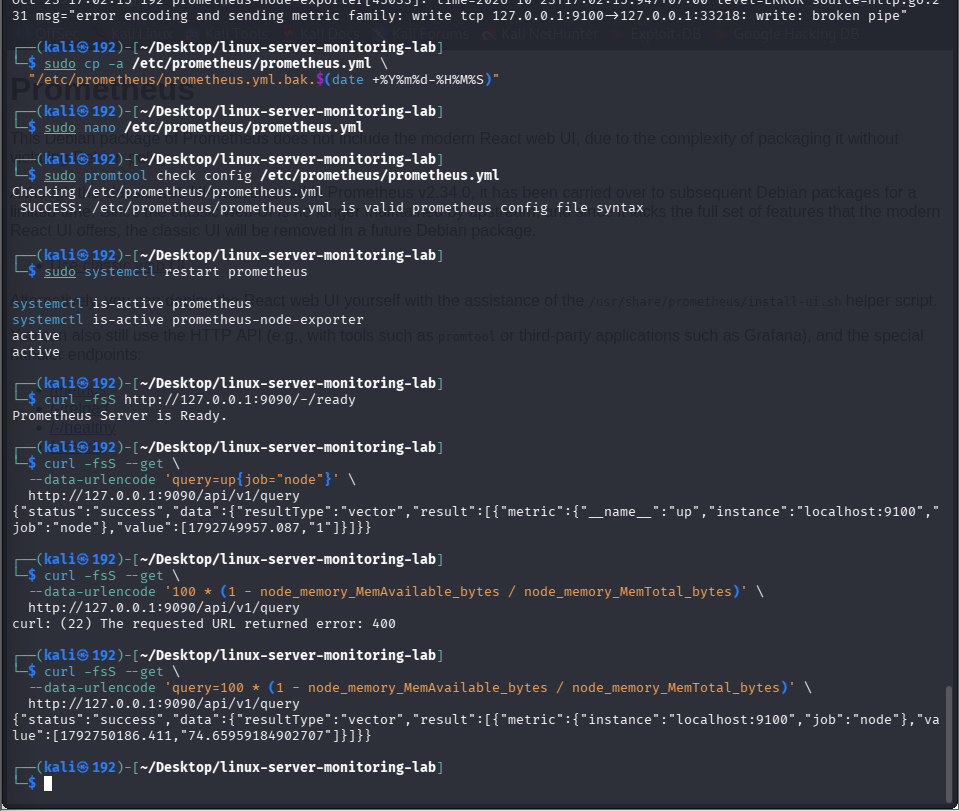

# Linux Server & Network Monitoring Lab

Phòng lab cá nhân để thực hành các nhiệm vụ nền tảng của **Linux System Administration, System Monitoring, IT Support và Network Operations/NOC**. Dự án được thực hiện trên Kali Linux chạy trong máy ảo VMware, sử dụng Bash, `systemd`, Nginx, Prometheus, Node Exporter và Grafana.

> **Trạng thái:** các bài lab chính đã được thực hành trên máy ảo. Repository gồm tài liệu quy trình, báo cáo và 8 ảnh chụp từ chính VM, trong đó có ảnh dashboard Grafana và ảnh kiểm tra Prometheus. Ảnh systemd timer và backup/restore vẫn chưa có; danh sách cần bổ sung nằm trong [checklist bằng chứng](docs/evidence-checklist.md).

## Mục tiêu dự án

- Khảo sát tài nguyên và trạng thái cơ bản của Linux.
- Viết script Bash kiểm tra CPU, load average, RAM, filesystem, interface mạng, default route, DNS, systemd, Nginx, socket và phản hồi HTTP.
- Tự động chạy healthcheck theo lịch bằng user `systemd timer`.
- Triển khai Nginx và thực hành quy trình phát hiện, chẩn đoán, khôi phục dịch vụ.
- Thực hành sao lưu/khôi phục tệp website và xác minh tính toàn vẹn bằng SHA-256.
- Chẩn đoán mạng theo thứ tự interface → địa chỉ/route → kết nối IP → DNS → TCP/port → HTTP/HTTPS.
- Thu thập và truy vấn metrics Linux bằng Prometheus + Node Exporter, trực quan hóa dữ liệu bằng dashboard Grafana.
- Viết tài liệu kỹ thuật bằng Markdown để tái hiện các bước và diễn giải kết quả thực tế.

## Kiến trúc tổng quan



Prometheus và Node Exporter chạy trong cùng máy ảo; Grafana dùng Prometheus làm nguồn dữ liệu. Các cổng được ghi trong sơ đồ là cổng mặc định/được dùng trong lab, không phải cấu hình được khuyến nghị mở ra Internet. Xem [kiến trúc và môi trường](docs/architecture.md).

## Công nghệ và công cụ

| Công cụ                                                    | Vai trò trong lab                                                          |
| ------------------------------------------------------------ | --------------------------------------------------------------------------- |
| Kali GNU/Linux Rolling                                       | Hệ điều hành thực hành trong VMware                                   |
| Bash                                                         | Tự động hóa kiểm tra hệ thống và ghi báo cáo                      |
| `systemd` / `journalctl`                                 | Quản lý dịch vụ, chạy tác vụ định kỳ và đọc nhật ký          |
| Nginx                                                        | Web server để kiểm tra HTTP, port và log; thực hành incident response |
| `ip`, `ip route`, `ping`, `getent`, `curl`, `ss` | Chẩn đoán network, DNS, TCP và ứng dụng                               |
| Prometheus                                                   | Thu thập và truy vấn metrics theo thời gian                             |
| Prometheus Node Exporter                                     | Xuất metrics của hệ điều hành Linux                                   |
| Grafana                                                      | Dashboard trực quan hóa metrics Prometheus                                |
| `tar`, `sha256sum`                                       | Sao lưu/khôi phục và xác minh tính toàn vẹn                         |

## Các task đã thực hiện

| Task | Nội dung                               | Kết quả                                                                                                                                 |
| ---- | --------------------------------------- | ----------------------------------------------------------------------------------------------------------------------------------------- |
| 1    | Bash `healthcheck.sh`                 | Kiểm tra CPU/load, RAM, disk, mạng/DNS, systemd, Nginx, port và HTTP; trả tổng kết `OK` / `WARNING` / `CRITICAL`              |
| 2    | Nginx incident response                 | Chủ động dừng Nginx, xác nhận HTTP/port không khả dụng, khôi phục service và xác minh HTTP `200`                           |
| 3    | Backup & Restore                        | Tạo archive, thay đổi thử nghiệm `index.html`, khôi phục và xác minh SHA-256 trả `OK`                                       |
| 4    | Tự động hóa bằng `systemd timer` | User timer được bật theo lịch 30 phút; service được điều chỉnh để chạy script qua Bash sau lỗi quyền thực thi ban đầu |
| 5    | Network Troubleshooting                 | Kiểm tra interface, địa chỉ/route, ping IP, DNS và HTTPS; thực hành kiểm tra âm DNS và port TCP                                 |
| 6    | Monitoring chuyên dụng                | Prometheus và Node Exporter hoạt động; dashboard Grafana đã được tạo, có ảnh minh chứng ở mục bên dưới                                   |

**Giới hạn minh chứng:** log chi tiết của baseline mạng và các lệnh chính chưa được lưu vào repository. Hiện có 8 ảnh: khảo sát ban đầu, DNS, Nginx, socket, dashboard Grafana và quá trình kiểm tra/truy vấn Prometheus. Ảnh timer, backup/restore, trang Targets và bài target `UP → DOWN → UP` của Node Exporter vẫn chưa có; sẽ chụp thật theo [checklist bằng chứng](docs/evidence-checklist.md).

## Ảnh minh chứng hiện có

### Khảo sát tài nguyên hệ thống



### Kiểm tra DNS



### Kiểm tra Nginx, cổng HTTP và access log



### Kiểm tra systemd và socket



### Dashboard Grafana

Dashboard với bốn panel Node Exporter Status, CPU, RAM và Disk:



### Cấu hình Prometheus và truy vấn qua API

Backup `prometheus.yml` trước khi sửa, `promtool check config` trả SUCCESS, restart service, hai service `active`, readiness OK, và truy vấn `up{job="node"}` cùng query RAM qua API. Lần thử đầu gửi sai cú pháp bị trả HTTP 400, sửa lại thì thành công:



> **Trước khi public:** Một số ảnh vẫn có dấu nhắc terminal/hostname hoặc chi tiết mạng và mã định danh máy ảo. Mình che hoặc cắt chúng trước khi tải repository lên GitHub công khai; xem [rà soát dữ liệu nhạy cảm](docs/architecture.md#rà-soát-thông-tin-trước-khi-công-khai).

## Cách chạy healthcheck

Từ thư mục gốc của repository:

```bash
chmod +x scripts/healthcheck.sh
./scripts/healthcheck.sh
printf 'Exit code: %s\n' "$?"
```

Script tự xác định thư mục dự án dựa trên vị trí của file, không cần đường dẫn Home được hard-code. Báo cáo mới nằm trong `reports/healthcheck-*.txt`. Các báo cáo tự sinh bị `.gitignore` loại khỏi Git mặc định vì có thể chứa số liệu môi trường thay đổi theo máy.

Mặc định, script dùng các ngưỡng CPU `80/95%`, RAM `80/90%`, filesystem gốc `80/90%`, load average 1 phút trên mỗi CPU logic `1.0/2.0`. Mã thoát: `0` = tất cả kiểm tra OK; `1` = có WARNING nhưng không có CRITICAL; `2` = có CRITICAL hoặc cấu hình đầu vào không hợp lệ. Chi tiết trong [hướng dẫn healthcheck](docs/healthcheck-script.md).

## Cấu trúc repository

```text
linux-server-monitoring-lab/
├── README.md
├── .gitignore
├── scripts/
│   └── healthcheck.sh
├── systemd/
│   └── user/
│       ├── linux-healthcheck.service.example
│       └── linux-healthcheck.timer
├── docs/
│   ├── architecture.md
│   ├── healthcheck-script.md
│   ├── systemd-timer.md
│   ├── nginx-deployment.md
│   ├── network-troubleshooting.md
│   ├── backup-restore.md
│   ├── prometheus-monitoring.md
│   ├── evidence-checklist.md
│   └── incident-reports/
│       ├── incident-template.md
│       └── nginx-service-down.md
├── images/
│   ├── dns_resole_check.png
│   ├── env_check.png
│   ├── grafana_dashboard.png
│   ├── host_check.png
│   ├── prometheus_node_check_cpu.png
│   ├── ram_and_disk_check.png
│   ├── service_monitor.png
│   ├── services_err_and_ports_check.png
│   └── README.md
└── reports/
    └── baseline-example.txt
```

Các archive backup và báo cáo thô sinh ra khi chạy không được đưa vào repository theo mặc định. Tám ảnh trong `images/` là ảnh gốc chụp từ VM, được giữ lại nguyên vẹn.

## Tài liệu chi tiết

- [Kiến trúc và khảo sát môi trường](docs/architecture.md)
- [Hướng dẫn và ngưỡng của `healthcheck.sh`](docs/healthcheck-script.md)
- [Tự động chạy healthcheck bằng systemd user timer](docs/systemd-timer.md)
- [Triển khai và vận hành Nginx](docs/nginx-deployment.md)
- [Báo cáo sự cố Nginx](docs/incident-reports/nginx-service-down.md)
- [Báo cáo Backup &amp; Restore](docs/backup-restore.md)
- [Network Troubleshooting](docs/network-troubleshooting.md)
- [Prometheus, Node Exporter và Grafana](docs/prometheus-monitoring.md)
- [Danh sách ảnh và bằng chứng cần bổ sung](docs/evidence-checklist.md)
- [Mẫu báo cáo sự cố](docs/incident-reports/incident-template.md)

## An toàn và giới hạn

- Đây là lab một máy phục vụ học tập, không phải kiến trúc monitoring production.
- Không chạy lệnh dừng/khởi động dịch vụ trên máy production hoặc máy không thuộc quyền quản lý của mình.
- Prometheus, Node Exporter và Grafana đang được sử dụng cho kiểm tra cục bộ; không mở cổng quản trị ra mạng ngoài nếu chưa thiết kế xác thực và kiểm soát truy cập phù hợp.
- Mức RAM, dung lượng đĩa, ngưỡng và kết quả metrics thay đổi theo thời điểm; giá trị lịch sử trong tài liệu không phải số liệu hiện tại.
- Trước khi công khai, cần làm sạch hostname, IP/MAC/gateway, ID máy ảo, log thô, báo cáo cá nhân và các ảnh chụp terminal.

## Hướng phát triển tiếp theo

1. Chụp thêm trang Prometheus Targets từ chính VM (dashboard Grafana đã có ảnh).
2. Lưu bằng chứng có thời gian cho một lần chạy `systemd timer` tự động.
3. Thực hành có kiểm soát để target Node Exporter chuyển `UP → DOWN → UP` và ghi báo cáo incident riêng.
4. Chỉ cân nhắc mở rộng Zabbix, cảnh báo hoặc giám sát máy thứ hai sau khi phần lab hiện tại được ghi chép và kiểm chứng đầy đủ.
