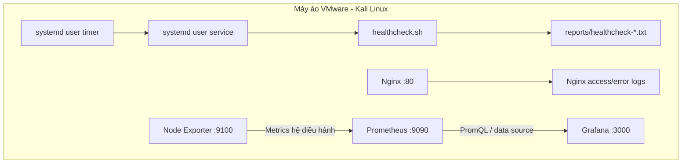
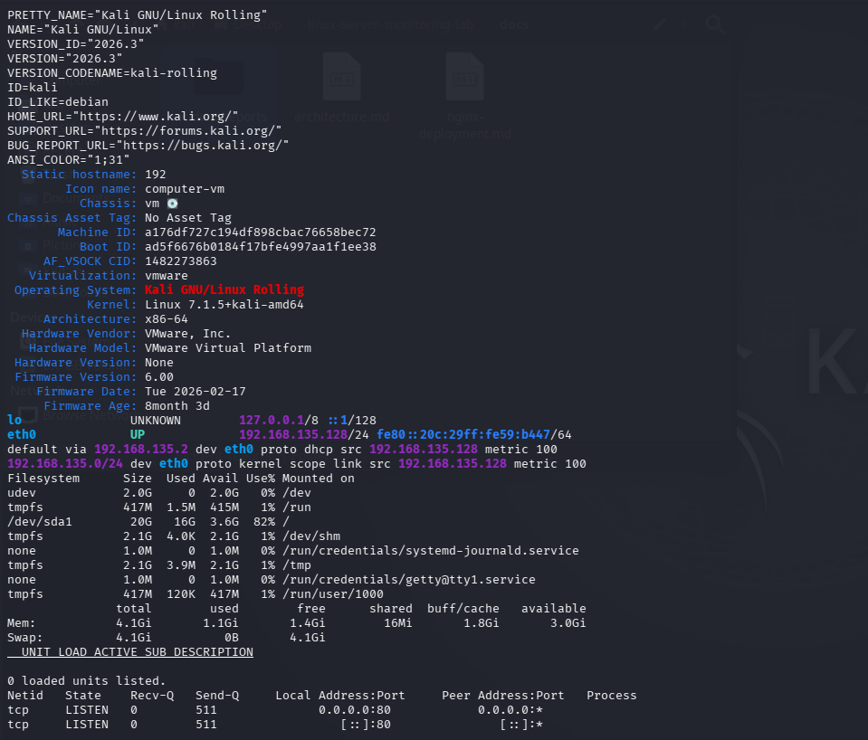
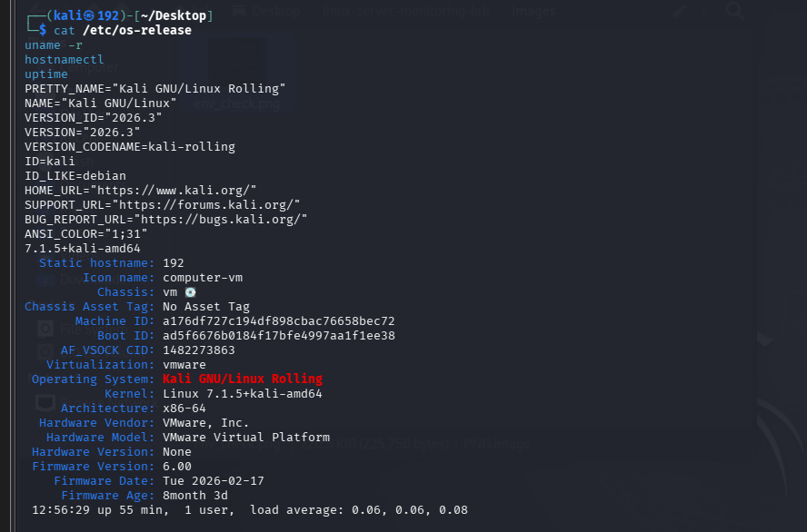

# Kiến trúc và khảo sát môi trường

## 1. Mục đích

Tài liệu này mô tả môi trường lab, luồng hoạt động giữa các thành phần và những thông tin đã quan sát được trong quá trình thực hành. Số liệu tài nguyên thay đổi theo thời điểm; không dùng một snapshot cũ để đại diện cho trạng thái hiện tại của máy.

## 2. Môi trường thực hành

| Hạng mục          | Thông tin đã ghi nhận                                                                                                           |
| ------------------- | ----------------------------------------------------------------------------------------------------------------------------------- |
| Hệ điều hành    | Kali GNU/Linux Rolling 2026.3                                                                                                       |
| Kernel              | `7.1.5+kali-amd64` trong lần khảo sát ban đầu                                                                                |
| Kiến trúc         | `x86_64`                                                                                                                          |
| Nền tảng ảo hóa | VMware                                                                                                                              |
| CPU logic           | 4                                                                                                                                   |
| RAM VM              | Khoảng 2 GiB trong giai đoạn cài monitoring; snapshot sớm hơn ghi nhận 4,1 GiB trước khi VM được điều chỉnh          |
| Filesystem gốc     | Sau khi mở rộng phân vùng: khoảng 24 GiB tổng; một lần kiểm tra ghi nhận 16 GiB đã dùng, 6,7 GiB còn trống (70%)     |
| Swap                | Sau thao tác phân vùng, `swapon --show` ghi nhận phân vùng swap khoảng 2,5 GiB; mức dùng 0 B tại thời điểm kiểm tra |
| Web server          | Nginx                                                                                                                               |
| Monitoring          | Prometheus, Prometheus Node Exporter và Grafana                                                                                    |
| Tự động hóa     | Bash và `systemd` user service/timer                                                                                             |

**Quan trọng:** các giá trị trên lấy từ nhiều thời điểm trong quá trình học. Sau khi cài Grafana hoặc thay đổi phân vùng, hãy chạy `free -h`, `df -h /`, `nproc` và `swapon --show` để ghi lại trạng thái mới nhất. Không coi các số liệu trong bảng là phép đo đồng thời.

## 3. Sơ đồ thành phần

Sơ đồ mô tả các thành phần trong máy lab hiện tại. Node Exporter xuất số liệu, Prometheus thu thập và lưu metrics, còn Grafana truy vấn Prometheus để hiển thị dashboard. `healthcheck.sh` là công cụ kiểm tra theo từng lần chạy, khác với hệ metrics liên tục của Prometheus.

## 4. Kết quả baseline đã có bằng chứng

- Interface Ethernet được kiểm tra ở trạng thái `UP` và có cờ `LOWER_UP`.
- Bảng định tuyến có default route.
- Ping đến địa chỉ IP thử nghiệm nhận 4/4 gói, packet loss 0%, RTT trung bình xấp xỉ 51,1 ms trong lần đo đã ghi nhận.
- `getent ahosts google.com` trả về kết quả IPv4 và IPv6.
- `curl` tới `https://example.com/` nhận HTTP `200`.
- Nginx đã lắng nghe cổng TCP 80 và phục vụ trang thử nghiệm với HTTP `200`.
- Sự cố Nginx được mô phỏng có chủ đích, phát hiện bằng `systemctl`, `curl`, `ss` và healthcheck; sau đó dịch vụ được khôi phục và xác minh HTTP `200`.
- Backup của trang web và cấu hình Nginx được tạo; sau khi thay đổi thử nghiệm `index.html`, file được khôi phục và SHA-256 kiểm tra trả `OK`.
- Prometheus và Node Exporter đã được bật, endpoint readiness Prometheus trả thông báo sẵn sàng, và truy vấn RAM trả kết quả khoảng 74,66% ở một thời điểm cụ thể.
- Dashboard Grafana đã được tạo với các panel Node Exporter Status, CPU, RAM và filesystem; ảnh dashboard có trong `images/grafana_dashboard.png`.

## 5. Ảnh khảo sát hiện có

### Tổng hợp môi trường và thông tin hệ thống

### Hệ điều hành và kernel

### RAM, filesystem và thiết bị lưu trữ

### Trạng thái unit lỗi và socket lắng nghe

Các ảnh trên là ảnh gốc đã được giữ nguyên. Chúng minh họa một số trạng thái khảo sát ban đầu; không phải ảnh chụp dashboard Prometheus/Grafana hoặc bằng chứng cho mọi task sau này.

## 6. Rà soát thông tin trước khi push

Trước khi đẩy ảnh lên repository công khai, cần tự xem lại và che những chi tiết không muốn tiết lộ. Đặc biệt:

- `images/env_check.png`: rà soát dấu nhắc terminal, địa chỉ mạng, gateway, MAC và mã định danh máy ảo.
- `images/host_check.png`: rà soát hostname/dấu nhắc terminal, địa chỉ mạng và mã định danh máy.
- `images/ram_and_disk_check.png`: rà soát dấu nhắc terminal và tên người dùng/host nếu có.
- `images/dns_resole_check.png`: rà soát dấu nhắc terminal và địa chỉ phân giải nếu muốn che thông tin môi trường.
- `images/service_monitor.png`: kiểm tra chi tiết trong access log và dấu nhắc terminal.
- `images/services_err_and_ports_check.png`: rà soát hostname/dấu nhắc terminal.

Script healthcheck mới chủ động lược bỏ IP, MAC, gateway, URL HTTP và tên các systemd unit lỗi khỏi báo cáo; tuy nhiên, vẫn cần đọc báo cáo trước khi chia sẻ. Không commit các archive backup hoặc log thô chỉ vì chúng được tạo trong lab.

## 7. Giới hạn và điều không nên diễn

- Lab hiện chạy các thành phần trên cùng một máy ảo; chưa chứng minh việc giám sát từ xa nhiều server.
- Một lần ping thành công không đảm bảo mọi route hoặc dịch vụ đều hoạt động.
- Một lần HTTP `200` chỉ chứng minh endpoint đã trả lời tại thời điểm kiểm tra.
- Một dashboard hoạt động không tự chứng minh đã thiết lập cảnh báo, SLA, phân quyền hay lưu trữ metrics dài hạn theo tiêu chuẩn production.
- Mức RAM và dung lượng filesystem đã thay đổi trong quá trình mở rộng VM và cài công cụ; hãy ghi ngày/giờ khi chụp số liệu mới.

## 8. Hướng phát triển

1. Bổ sung ảnh thực tế của `systemd timer`, Prometheus Targets và Grafana dashboard.
2. Lưu bằng chứng cho lần chạy tự động của healthcheck, không chỉ lần chạy thủ công.
3. Thực hiện bài thử Prometheus target `UP → DOWN → UP` nếu muốn chứng minh phát hiện mất metrics và khôi phục.
4. Nếu cần mô phỏng hạ tầng đa máy, bổ sung một server VM thứ hai khi đủ tài nguyên.
