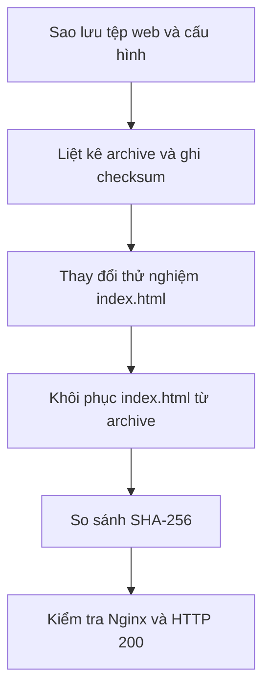

# Báo cáo thực hành: Sao lưu và khôi phục (Backup & Restore)


- **Môi trường:** Kali Linux trong máy ảo VMware, Nginx đang phục vụ trang lab
- **Trạng thái:** **Thành công - đã xác minh khôi phục**
- **Phạm vi:** Sao lưu cấu hình Nginx và trang web thử nghiệm; trong phần khôi phục chỉ phục hồi `index.html` vì hai file cấu hình không bị thay đổi.

## 1. Mục tiêu

1. Tạo archive chứa các file quan trọng của lab.
2. Kiểm tra archive đọc được và có đủ các file dự kiến.
3. Ghi checksum SHA-256 của archive và của `index.html` trước khi thử nghiệm.
4. Mô phỏng thay đổi nhầm nội dung website.
5. Khôi phục file từ bản backup và xác minh tính toàn vẹn.
6. Kiểm tra Nginx và HTTP sau khôi phục.



## 2. Phạm vi backup

Archive được tạo với ba đường dẫn bên trong:

```text
var/www/html/index.html
etc/nginx/nginx.conf
etc/nginx/sites-available/default
```

Tên archive được tạo theo mẫu `nginx-lab-<TIMESTAMP>.tar.gz` (timestamp theo định dạng `YYYYMMDD-HHMMSS`). Archive nằm trong thư mục cục bộ `backups/` của project ở thời điểm thực hành; không cần commit archive đó lên GitHub.

## 3. Tạo và kiểm tra archive

Các lệnh đã chạy:

```bash
mkdir -p backups
STAMP=$(date +%Y%m%d-%H%M%S)
ARCHIVE="$PWD/backups/nginx-lab-$STAMP.tar.gz"

sudo tar -czf "$ARCHIVE" -C / \
  var/www/html/index.html \
  etc/nginx/nginx.conf \
  etc/nginx/sites-available/default

sudo chown "$(id -un):$(id -gn)" "$ARCHIVE"
sha256sum "$ARCHIVE" | tee "$ARCHIVE.sha256"
tar -tzf "$ARCHIVE"
```

Kết quả: archive được tạo; lệnh `tar -tzf` liệt kê đủ ba đường dẫn nói trên.

### Checksum của archive

Checksum được in khi tạo archive:

```text
232360b4205057bbbabdb50543822c24302c589cdc4d2f22918fa61eaef14ac0  nginx-lab-<TIMESTAMP>.tar.gz
```

Đây là giá trị ghi nhận từ đầu ra tạo archive. Trong các bước đã thực hiện không có lệnh xác minh riêng `sha256sum -c` cho chính archive; do đó chỉ kết luận archive được tạo và liệt kê thành công. Không tuyên bố checksum archive đã được kiểm tra lại độc lập.

### Checksum của trang web trước khi thử

Trước khi thay đổi thử nghiệm, lệnh:

```bash
sha256sum /var/www/html/index.html \
  | tee "$PWD/backups/index-before-$STAMP.sha256"
```

ghi lại giá trị:

```text
500d386112f02db2f14588985c395c11c6a94360237b966693287fcf92bea12a  /var/www/html/index.html
```

## 4. Mô phỏng thay đổi nhầm nội dung

Bản gốc được sao chép tạm thời vào `/tmp`, sau đó thay `index.html` bằng nội dung thử nghiệm:

```bash
sudo cp -a /var/www/html/index.html \
  /tmp/index.html.before-restore-test

echo '<h1>Temporary Restore Test</h1>' \
  | sudo tee /var/www/html/index.html >/dev/null
```

Lệnh kiểm tra `curl -sS http://127.0.0.1/ | head` trả về:

```html
<h1>Temporary Restore Test</h1>
```

Điều này xác nhận nội dung thử nghiệm đã thay thế trang ban đầu. Tác động chỉ nằm trong trang web của VM lab.

## 5. Khôi phục

Khôi phục riêng file `index.html` từ archive:

```bash
sudo tar -xzf "$ARCHIVE" -C / var/www/html/index.html
```

Sau đó kiểm tra checksum:

```bash
sudo sha256sum -c "$PWD/backups/index-before-$STAMP.sha256"
```

Kết quả thực tế:

```text
/var/www/html/index.html: OK
```

Checksum sau khôi phục khớp với checksum đã ghi trước khi mô phỏng thay đổi. Hai file cấu hình Nginx đã được backup nhưng không cần restore trong bài này vì chúng không bị chỉnh sửa.

## 6. Xác minh dịch vụ và website sau khôi phục

Các bước đã được thực hiện:

```bash
sudo nginx -t
systemctl is-active nginx
curl --connect-timeout 2 --max-time 5 \
  -sS -o /dev/null \
  -w 'HTTP status: %{http_code}\n' \
  http://127.0.0.1/
curl -sS http://127.0.0.1/ | head -n 12
```

Kết quả thực tế:

| Kiểm tra                    | Kết quả                                             | Đánh giá |
| ---------------------------- | ----------------------------------------------------- | ----------- |
| Nội dung archive            | Đủ ba file dự kiến                                | Đạt       |
| SHA-256 file sau khôi phục | `index.html: OK`                                    | Đạt       |
| Cấu hình Nginx             | Syntax OK; test successful                            | Đạt       |
| Trạng thái service         | `active`                                            | Đạt       |
| HTTP                         | `200`                                               | Đạt       |
| Nội dung trang              | Trở lại trang Linux Server & Network Monitoring Lab | Đạt       |

## 7. Kết luận

Thay đổi thử nghiệm của website đã được đảo ngược thành công. Nội dung được khôi phục khớp checksum đã ghi trước đó, Nginx vượt qua kiểm tra cấu hình, service ở trạng thái `active` và HTTP trả `200`. Quy trình backup/restore của file website trong lab được xác minh thành công.

## 8. Bằng chứng hình ảnh

Repository hiện chưa có ảnh chụp riêng cho bước tạo archive, nội dung tạm thời, checksum `OK` hoặc HTTP `200` sau khôi phục.Để tăng chất lượng portfolio, hãy lưu các ảnh đó từ chính VM, che thông tin nhận diện, rồi đưa vào `images/` theo [checklist bằng chứng](evidence-checklist.md). Không dùng ảnh minh họa giả thay cho kết quả thực tế.

## 9. Vệ sinh repository

- Giữ tài liệu quy trình và báo cáo đã làm sạch trong Git.
- Không commit archive backup lặp lại hoặc cấu hình production có thông tin nhạy cảm.
- Thư mục `/backups/` được `.gitignore` loại trừ mặc định.
- Khi sao lưu hệ thống thật, cần cân nhắc quyền file, chủ sở hữu, dữ liệu nhạy cảm, chính sách lưu giữ và quy trình phê duyệt trước khi restore.
