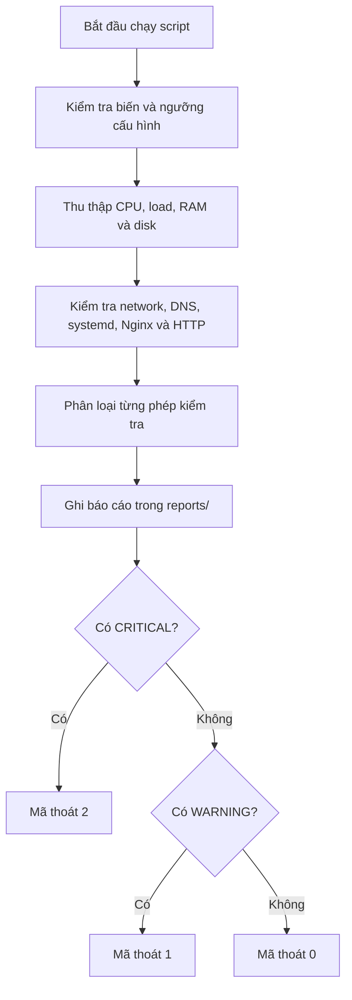

# Hướng dẫn `healthcheck.sh`

## Mục tiêu

`healthcheck.sh` thực hiện một lần kiểm tra trạng thái hiện tại (point-in-time health check), ghi kết quả vào `reports/` và in tổng kết `OK`, `WARNING` hoặc `CRITICAL`. Script hướng đến lab Linux System / IT Support / NOC; đây chưa phải giải pháp monitoring liên tục.


## Luồng hoạt động




## Cách chạy

Từ thư mục gốc repository:

```bash
chmod +x scripts/healthcheck.sh
./scripts/healthcheck.sh
```

Không cần `sudo` cho các kiểm tra cơ bản. Báo cáo chứa trạng thái và số liệu tổng quát; script chủ động bỏ qua hostname, địa chỉ IP/MAC, gateway, địa chỉ lắng nghe cụ thể và tên các systemd unit lỗi. File báo cáo mới được tạo với quyền riêng tư theo `umask 077`.

## Hạng mục được kiểm tra

| Hạng mục | Cách đánh giá |
|---|---|
| Hệ điều hành | Distribution, kernel, kiến trúc, virtualization và uptime |
| CPU | Ước tính phần trăm CPU bận từ hai mẫu `/proc/stat` |
| Load average | Load 1/5/15 phút; đánh giá load 1 phút theo số CPU logic |
| RAM | Dựa trên `MemAvailable` trong `/proc/meminfo` khi có thể |
| Filesystem gốc | Phần trăm sử dụng và dung lượng tổng/đã dùng/còn trống của `/` |
| Mạng | Số interface không phải loopback ở trạng thái UP; có/không default route |
| DNS | Phân giải một domain thử nghiệm; không ghi địa chỉ kết quả vào báo cáo |
| systemd | Số lượng failed units; không ghi tên unit vào báo cáo |
| Nginx | Kiểm tra cài đặt và trạng thái process/service nếu phát hiện Nginx |
| TCP port 80 | Kiểm tra có socket lắng nghe trên port 80 hay không |
| HTTP | Gửi request tới endpoint cấu hình bằng `curl`, chỉ ghi mã HTTP, không ghi URL |
| Listening sockets | Ghi số lượng socket TCP/UDP; không ghi endpoint hoặc port chi tiết |

## Lưu ý triển khai load average

Phiên bản script hiện tại dùng biến AWK `load_value` để tránh xung đột với tên dựng sẵn `load` của GNU awk (`gawk`). Lỗi này đã xuất hiện ở bản cũ trong quá trình thực hành và sau đó được sửa; khi clone repository mới hoặc thay script, nên chạy lại và xác nhận dòng `[OK]`, `[WARNING]` hoặc `[CRITICAL] Load average` có giá trị `1m load/core` hợp lệ.

## Ngưỡng mặc định

| Chỉ số | WARNING | CRITICAL |
|---|---:|---:|
| CPU utilization | 80% | 95% |
| RAM utilization | 80% | 90% |
| Filesystem `/` | 80% | 90% |
| Load average 1 phút / mỗi CPU logic | 1.0 | 2.0 |

Ngưỡng này là mặc định phù hợp cho bài lab, không phải tiêu chuẩn áp dụng cho mọi máy chủ. Load average cao không đồng nghĩa trực tiếp với CPU utilization cao; nên xem cả hai chỉ số và đối chiếu loại workload.

## Tùy chỉnh bằng biến môi trường

Ví dụ đổi domain DNS và endpoint HTTP cần kiểm tra:

```bash
DNS_TEST_DOMAIN=example.com \
HTTP_URL=http://127.0.0.1/ \
./scripts/healthcheck.sh
```

Có thể điều chỉnh ngưỡng mà không sửa file script:

```bash
CPU_WARN=75 CPU_CRIT=90 \
MEM_WARN=75 MEM_CRIT=90 \
DISK_WARN=75 DISK_CRIT=90 \
./scripts/healthcheck.sh
```

Các biến khả dụng:

| Biến | Mặc định | Ý nghĩa |
|---|---|---|
| `CPU_WARN` / `CPU_CRIT` | `80` / `95` | Ngưỡng CPU utilization (%) |
| `MEM_WARN` / `MEM_CRIT` | `80` / `90` | Ngưỡng RAM utilization (%) |
| `DISK_WARN` / `DISK_CRIT` | `80` / `90` | Ngưỡng filesystem gốc (%) |
| `LOAD_WARN_PER_CORE` / `LOAD_CRIT_PER_CORE` | `1.0` / `2.0` | Ngưỡng load average 1 phút chia số CPU logic |
| `CPU_SAMPLE_SECONDS` | `1` | Khoảng giữa hai mẫu CPU; cho phép từ 1–5 giây |
| `HTTP_TIMEOUT` | `4` | Giới hạn thời gian HTTP, từ 1–20 giây |
| `HTTP_URL` | `http://127.0.0.1/` | Endpoint HTTP được kiểm tra; URL không được ghi vào report |
| `DNS_TEST_DOMAIN` | `google.com` | Domain dùng trong phép thử phân giải DNS |

Ngưỡng `WARNING` phải thấp hơn ngưỡng `CRITICAL`; các ngưỡng CPU/RAM/disk phải nằm trong khoảng 0–100. Script sẽ dừng với mã lỗi nếu cấu hình ngưỡng không hợp lệ.

## Ý nghĩa trạng thái và mã thoát

- `OK`: phép kiểm tra đạt ngưỡng hoặc điều kiện mong đợi.
- `WARNING`: có dấu hiệu cần xem xét, công cụ thiếu, hoặc điều kiện có thể là bình thường tùy cách cấu hình lab.
- `CRITICAL`: vượt ngưỡng nghiêm trọng, phát hiện systemd unit lỗi, Nginx đã cài nhưng không hoạt động, hoặc endpoint HTTP trả lỗi máy chủ/không phản hồi trong trường hợp Nginx đã cài.

Mã thoát của toàn bộ script:

| Mã | Ý nghĩa |
|---:|---|
| `0` | Tất cả các phép kiểm tra đều OK |
| `1` | Có ít nhất một WARNING, không có CRITICAL |
| `2` | Có ít nhất một CRITICAL hoặc cấu hình đầu vào không hợp lệ |

Một phép kiểm tra DNS thất bại được phân loại `WARNING` vì có thể do mạng của lab không kết nối Internet. Nginx chưa cài cũng chỉ là `WARNING`; khi Nginx đã cài nhưng không hoạt động thì là `CRITICAL`.

## Đọc kết quả và xử lý tiếp

1. Xem `Overall status` và đếm `OK` / `WARNING` / `CRITICAL`.
2. Với filesystem vượt ngưỡng, xác định thư mục tiêu tốn dung lượng trước khi xóa bất cứ thứ gì.
3. Với Nginx không hoạt động, kiểm tra `systemctl status nginx --no-pager` và `journalctl -u nginx --since "15 minutes ago" --no-pager`.
4. Với HTTP không phản hồi, kiểm tra service, port 80, URL cấu hình và log access/error của Nginx.
5. Với DNS lỗi, đối chiếu default route, khả năng kết nối và cấu hình resolver trước khi kết luận nguyên nhân.
6. Chạy lại sau khi xử lý và so sánh kết quả. Không tuyên bố đã khắc phục nếu chưa có phép kiểm tra sau xử lý.

## Giới hạn hiện tại

- Script chỉ ghi nhận trạng thái tại thời điểm chạy; không lưu metrics dài hạn hoặc tự gửi cảnh báo.
- CPU utilization là mẫu ngắn; workload thay đổi có thể làm số liệu dao động.
- Domain DNS và URL HTTP có thể được tùy chỉnh; kết quả chỉ phản ánh endpoint đã cấu hình.
- Kiểm tra port 80 không phù hợp nếu lab được cấu hình dùng một port khác.
- Trước khi chia sẻ report hoặc ảnh công khai, vẫn cần tự rà soát nội dung và thông tin môi trường.


## Tích hợp với systemd timer

Để chạy script theo lịch, xem [hướng dẫn systemd user timer](systemd-timer.md). Timer gọi script qua user service; báo cáo healthcheck giữ chi tiết `OK` / `WARNING` / `CRITICAL`, còn `journalctl --user` cho biết tác vụ có thực thi được hay không. Hai nguồn thông tin này cần được đọc cùng nhau.
