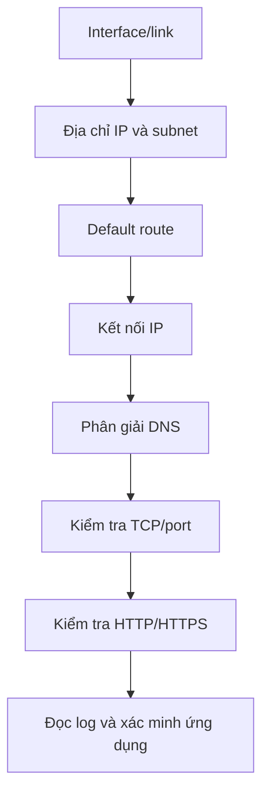

# Bài thực hành 5 - Khắc phục sự cố mạng (Network Troubleshooting)

> **Dự án:** Linux Server & Network Monitoring Lab  
> **Môi trường:** Kali GNU/Linux Rolling chạy trong máy ảo VMware
> **Phạm vi:** Kiểm tra trạng thái card mạng, địa chỉ IP, định tuyến, kết nối IP, phân giải DNS, truy cập HTTPS và phân biệt lỗi kết nối TCP với trạng thái dịch vụ ứng dụng.

## 1. Mục tiêu

Bài thực hành giúp xây dựng quy trình chẩn đoán mạng theo từng lớp thay vì chạy ngẫu nhiên nhiều lệnh. Sau khi hoàn thành, bạn có thể:

1. Xác định interface mạng có đang bật và có liên kết hay không.
2. Kiểm tra địa chỉ IP và default route.
3. Kiểm tra khả năng tiếp cận một địa chỉ IP bên ngoài.
4. Kiểm tra DNS riêng biệt với kết nối IP.
5. Xác nhận ứng dụng có phản hồi ở tầng HTTP/HTTPS hay không.
6. Phân biệt tình huống DNS không phân giải được với tình huống cổng TCP không có dịch vụ lắng nghe.
7. Ghi lại kết quả, diễn giải bằng chứng và giữ an toàn cho thông tin của máy lab.

## 2. Môi trường và nguyên tắc an toàn

- Hệ điều hành: Kali GNU/Linux Rolling.
- Nền tảng ảo hóa: VMware.
- Interface Ethernet được kiểm tra: `eth0`.
- Dịch vụ web thử nghiệm: Nginx, lắng nghe TCP cổng `80` trong lần kiểm tra trước đó.
- Địa chỉ IP nội bộ, gateway, địa chỉ MAC, hostname và các mã định danh của máy đã được lược khỏi tài liệu này.

**Nguyên tắc an toàn:** các bài kiểm tra chỉ dùng lệnh đọc thông tin và kết nối thử trong phạm vi lab. Không thay đổi ` /etc/resolv.conf`, cấu hình NetworkManager, routing, firewall hoặc router để tạo lỗi. Bài kiểm tra cổng dùng loopback `127.0.0.1`; không dừng dịch vụ thật chỉ để tạo tình huống thử nghiệm.

## 3. Mô hình chẩn đoán

Quy trình kiểm tra được thực hiện từ nền tảng mạng lên tầng ứng dụng:



1. **Interface/link:** card mạng có đang `UP` và có `LOWER_UP` hay không.
2. **Địa chỉ và tuyến đường:** interface có địa chỉ IP, subnet và default route hợp lệ hay không.
3. **Kết nối IP:** có thể gửi gói đến một IP kiểm tra hay không.
4. **DNS:** tên miền có được phân giải thành địa chỉ IP hay không.
5. **TCP/port:** có tiến trình lắng nghe tại cổng đích hay không.
6. **HTTP/HTTPS:** ứng dụng có phản hồi và trả mã trạng thái hợp lệ hay không.

Thành công ở một bước không tự động chứng minh tất cả bước còn lại đều tốt. Ví dụ, ping IP thành công không đảm bảo DNS hoạt động; DNS thành công cũng không đảm bảo dịch vụ web ở cổng đích đang chạy.

## 4. Kiểm tra trạng thái mạng ban đầu

### 4.1. Interface và liên kết mạng

**Lệnh đã chạy:**

```bash
ip -br link
ip -br addr
```

**Kết quả quan sát được:**

- Có interface loopback `lo` và interface Ethernet `eth0`.
- `eth0` hiển thị trạng thái `UP` cùng cờ `LOWER_UP`.
- Interface Ethernet có địa chỉ IPv4 thuộc mạng riêng với tiền tố `/24`.
- Interface có thêm địa chỉ IPv6 link-local.

**Diễn giải:** interface đã được bật và trạng thái liên kết của interface ảo đang hoạt động tại thời điểm kiểm tra. Địa chỉ IPv4 `/24` cho biết subnet mask tương đương `255.255.255.0` đối với địa chỉ đó.

**Giới hạn:** `UP` và `LOWER_UP` không tự chứng minh máy có thể truy cập Internet hoặc mọi dịch vụ đều hoạt động. Cần tiếp tục kiểm tra tuyến đường và kết nối thực tế.

### 4.2. Bảng định tuyến

**Lệnh đã chạy:**

```bash
ip route
```

**Kết quả quan sát được:**

- Có một tuyến `default` qua gateway được cấp trong mạng ảo.
- Có tuyến trực tiếp cho subnet nội bộ gắn với `eth0`.

**Diễn giải:** hệ thống có đường đi mặc định để gửi lưu lượng đến các mạng không khớp với tuyến cụ thể hơn. Thông tin gateway cụ thể đã được lược bỏ vì lý do riêng tư.

**Giới hạn:** sự hiện diện của default route chỉ xác nhận cấu hình tuyến đã tồn tại, không chứng minh gateway hoặc đường đi bên ngoài chắc chắn chuyển tiếp được lưu lượng. Bước kiểm tra kết nối IP bên dưới cung cấp thêm bằng chứng thực tế.

### 4.3. Kết nối đến địa chỉ IP bên ngoài

**Lệnh đã chạy:**

```bash
ping -c 4 -W 2 1.1.1.1
```

**Kết quả quan sát được:**

- Đã gửi 4 gói và nhận 4 gói.
- Mất gói: `0%`.
- RTT nhỏ nhất: khoảng `50.754 ms`.
- RTT trung bình: khoảng `51.094 ms`.
- RTT lớn nhất: khoảng `51.407 ms`.

**Đánh giá:** phép kiểm tra ICMP đến địa chỉ IP thử nghiệm thành công trong lần chạy này. Kết quả cho thấy kết nối IP đến đích kiểm tra hoạt động tại thời điểm đo.

**Giới hạn:** đây là phép thử ngắn đến một đích cụ thể. Nó không bảo đảm mọi địa chỉ đều truy cập được. Một số mạng có thể chặn ICMP; nếu ping thất bại thì không nên kết luận ngay rằng toàn bộ Internet bị mất.

### 4.4. Phân giải tên miền DNS

**Lệnh đã chạy:**

```bash
getent ahosts google.com
```

**Kết quả quan sát được:**

- Lệnh trả về các bản ghi địa chỉ IPv4 và IPv6 cho `google.com`.

**Đánh giá:** việc tra cứu tên miền đã thành công tại thời điểm kiểm tra. `getent ahosts` sử dụng cơ chế phân giải tên của hệ điều hành, vì vậy hữu ích để kiểm tra khả năng phân giải mà ứng dụng trên máy thường sử dụng.

**Giới hạn:** kết quả này không xác định riêng máy chủ DNS nào đã trả lời, cũng không bảo đảm mọi tên miền đều phân giải được. Cache, cấu hình resolver và chính sách mạng có thể ảnh hưởng đến kết quả.

### 4.5. Truy cập ứng dụng qua HTTPS

**Lệnh đã chạy:**

```bash
curl -sS -o /dev/null \
  -w 'HTTP status: %{http_code}\n' \
  --connect-timeout 3 \
  --max-time 8 \
  https://example.com/
```

**Kết quả quan sát được:**

```text
HTTP status: 200
```

**Đánh giá:** client đã nhận phản hồi HTTP `200` từ website thử nghiệm qua HTTPS. Cùng với kết quả DNS và ping IP thành công, điều này củng cố nhận định rằng kết nối mạng cơ bản hoạt động bình thường trong thời điểm kiểm tra.

**Giới hạn:** mã `200` từ một website không chứng minh mọi ứng dụng, cổng hoặc đường mạng khác đều hoạt động. Nếu `curl` trả mã `000`, cần đọc thông báo lỗi và mã thoát để xác định bước kết nối thất bại.

## 5. Bài kiểm tra âm DNS - tên miền được dành riêng cho thử nghiệm

### 5.1. Mục đích

Bài kiểm tra này minh họa sự khác nhau giữa một tên miền được phân giải thành công và một tên miền được dành riêng để không phân giải. Tên miền `.invalid` được dành riêng cho mục đích này; kiểm tra thất bại với tên đó là kết quả dự kiến, không phải bằng chứng rằng DNS của máy đang hỏng.

### 5.2. Lệnh thực hành

```bash
getent ahosts does-not-exist.invalid
printf 'getent exit code: %s\n' "$?"
```

Sau đó đối chiếu với một tên miền thông thường:

```bash
getent ahosts example.com
printf 'getent exit code: %s\n' "$?"
```

### 5.3. Cách diễn giải

- Với `does-not-exist.invalid`, kết quả dự kiến là không có bản ghi địa chỉ và mã thoát khác `0`.
- Với `example.com`, thông thường lệnh sẽ trả về một hoặc nhiều địa chỉ và mã thoát `0` nếu quá trình phân giải thành công.
- Luôn lưu đầu ra thật cùng mã thoát; không chỉ ghi kết quả dự kiến vào báo cáo.

**Tình trạng bằng chứng:** Bài kiểm tra này đã được thực hiện, nhưng đầu ra và mã thoát cụ thể chưa được lưu lại. Vì thế báo cáo chỉ ghi nhận đây là bài thực hành đã hoàn thành, không khẳng định một mã thoát cụ thể.

## 6. Phân biệt lỗi TCP/port với lỗi DNS và lỗi ứng dụng

### 6.1. Kiểm tra listener ở cổng thử nghiệm

**Lệnh:**

```bash
sudo ss -ltnp 'sport = :18081'
```

Lệnh này liệt kê socket TCP đang lắng nghe tại cổng `18081`. Nếu không có đầu ra, điều đó có nghĩa không thấy TCP listener ở cổng này tại thời điểm kiểm tra. Trước khi sử dụng cổng thử nghiệm, cần kiểm tra để tránh giả định một cổng luôn trống trên mọi máy.

### 6.2. Thử kết nối HTTP đến cổng thử nghiệm

**Lệnh:**

```bash
curl --connect-timeout 2 --max-time 4 \
  -sS -o /dev/null \
  -w 'HTTP status: %{http_code}\n' \
  http://127.0.0.1:18081/

echo "Curl exit code: $?"
```

Nếu không có dịch vụ lắng nghe tại cổng này, kết quả thường gặp là `HTTP status: 000` cùng mã thoát `7` của `curl` khi kết nối bị từ chối. Mã `000` không phải là mã trạng thái HTTP do máy chủ trả về; nó biểu thị rằng `curl` chưa nhận được mã HTTP.

Vì địa chỉ dùng là `127.0.0.1`, phép thử này không cần DNS. Khi không kết nối được với một cổng loopback, cần xem xét trạng thái listener hoặc cấu hình cục bộ trước, thay vì kết luận lỗi DNS.

### 6.3. So sánh với Nginx ở cổng 80

**Lệnh:**

```bash
curl --connect-timeout 2 --max-time 4 \
  -sS -o /dev/null \
  -w 'HTTP status: %{http_code}\n' \
  http://127.0.0.1/
```

Trong lần kiểm tra Nginx trước Task 5, dịch vụ đã được xác nhận hoạt động và trả HTTP `200`. Bài so sánh nhằm minh họa rằng kết nối đến một cổng không có listener có thể thất bại trong khi một ứng dụng khác trên cùng máy vẫn hoạt động.

**Tình trạng bằng chứng:** Bài kiểm tra cổng `18081` và phép so sánh với cổng `80` đã được thực hiện, nhưng đầu ra lệnh cụ thể chưa được lưu lại. Vì vậy, báo cáo không ghi một mã thoát hoặc kết quả cụ thể cho lượt thử đó. Có thể chạy lại các lệnh trên và lưu đầu ra để có bằng chứng trực tiếp trong kho mã.

## 7. Bảng tổng hợp chẩn đoán

| Lớp kiểm tra         | Lệnh chính                                  | Kết quả có bằng chứng trong log                                                   | Ý nghĩa                                                          |
| ---------------------- | --------------------------------------------- | -------------------------------------------------------------------------------------- | ------------------------------------------------------------------ |
| Interface/link         | `ip -br link`                               | `eth0` có `UP`, `LOWER_UP`                                                      | Interface và liên kết ảo đang hoạt động                    |
| Địa chỉ IP          | `ip -br addr`                               | Có IPv4 `/24` và IPv6 link-local                                                   | Interface đã có địa chỉ                                      |
| Định tuyến          | `ip route`                                  | Có default route                                                                      | Đã cấu hình tuyến mặc định                                 |
| Kết nối IP           | `ping -c 4 -W 2 1.1.1.1`                    | 4/4 gói, mất 0%, RTT trung bình ~51.094 ms                                          | Kết nối IP đến đích kiểm tra thành công                   |
| DNS thông thường    | `getent ahosts google.com`                  | Trả bản ghi IPv4 và IPv6                                                            | Phân giải tên miền thành công                                |
| HTTPS                  | `curl` đến `https://example.com/`       | HTTP `200`                                                                           | Nhận phản hồi HTTPS/HTTP thành công                           |
| DNS âm                | `getent ahosts does-not-exist.invalid`      | Đã thực hiện; chưa lưu đầu ra chi tiết                                        | Dùng để minh họa tên miền dự kiến không phân giải       |
| TCP cổng thử nghiệm | `ss` và `curl` đến `127.0.0.1:18081` | Đã thực hiện; chưa lưu đầu ra chi tiết                                        | Dùng để phân biệt listener/port với DNS                      |
| Nginx cổng 80         | `curl` đến `127.0.0.1/`                 | Nginx trước đó trả HTTP `200`; chưa lưu kết quả so sánh của lượt Task 5 | Dịch vụ web cục bộ đã hoạt động ở lần kiểm tra trước |

## 8. Quy trình xử lý sự cố tham khảo

Khi gặp tình trạng “không truy cập được website”, nên kiểm tra tuần tự và ghi lại kết quả thay vì thay đổi nhiều cấu hình cùng lúc.

1. **Xác nhận interface:** chạy `ip -br link` và `ip -br addr`. Kiểm tra interface có bị `DOWN` hoặc thiếu địa chỉ hay không.
2. **Kiểm tra route:** chạy `ip route`; xác định có default route nếu đích nằm ngoài subnet cục bộ.
3. **Kiểm tra kết nối IP:** ping một đích phù hợp nếu ICMP được phép. Nếu không phản hồi, xem xét gateway, routing, firewall hoặc chính sách ICMP trước khi kết luận.
4. **Kiểm tra DNS:** dùng `getent ahosts <tên-miền>`. Nếu truy cập bằng IP được nhưng tên miền không phân giải, kiểm tra resolver/DNS và thử một tên miền khác đã biết.
5. **Kiểm tra TCP:** dùng `ss -ltnp` trên máy chủ để xác định có tiến trình lắng nghe tại cổng đích không; dùng `curl` hoặc công cụ TCP phù hợp để kiểm tra kết nối.
6. **Kiểm tra ứng dụng:** với HTTP/HTTPS, ghi mã trạng thái, thông báo lỗi và mã thoát của client; trên máy chủ, kiểm tra service, log và cấu hình ứng dụng.
7. **Thay đổi từng yếu tố:** chỉ sau khi thu thập bằng chứng mới thay đổi cấu hình, sau đó chạy lại phép kiểm tra ban đầu để so sánh trước/sau.

### Bảng định hướng nhanh

| Triệu chứng                                             | Hướng kiểm tra đầu tiên                      | Lưu ý                                                                               |
| --------------------------------------------------------- | -------------------------------------------------- | ------------------------------------------------------------------------------------- |
| Interface `DOWN` hoặc không có địa chỉ            | `ip -br link`, `ip -br addr`                   | Kiểm tra trạng thái interface và cơ chế cấp địa chỉ                         |
| Không có default route                                  | `ip route`                                       | Kiểm tra cấu hình gateway/route; không thêm route khi chưa biết sơ đồ mạng |
| Ping IP không thành công                               | Route, gateway, firewall và chính sách ICMP     | ICMP có thể bị chặn; thử thêm loại kết nối khác                             |
| IP truy cập được nhưng tên miền không phân giải | `getent ahosts`, cấu hình resolver             | Có thể là DNS, cache hoặc cấu hình tên miền                                   |
| DNS thành công nhưng TCP thất bại                    | `ss -ltnp` trên máy đích, firewall và cổng | DNS chỉ cung cấp địa chỉ; không bảo đảm dịch vụ đang nghe                 |
| TCP kết nối được nhưng HTTP trả lỗi               | Mã HTTP, access/error log, cấu hình ứng dụng  | Kiểm tra tầng ứng dụng thay vì tập trung vào DNS                               |
| `curl` trả HTTP `000`                                | Đọc thông báo lỗi và mã thoát              | `000` không phải mã HTTP của máy chủ                                          |

## 9. Những gì bài lab đã chứng minh

Các log đã ghi nhận chứng minh rằng, tại thời điểm kiểm tra ban đầu:

- Interface Ethernet có trạng thái hoạt động và đã được cấp địa chỉ.
- Bảng định tuyến có default route.
- Lệnh ping đến địa chỉ IP thử nghiệm nhận đủ 4/4 gói, mất 0%.
- Tên miền `google.com` phân giải được thành các bản ghi IPv4 và IPv6.
- Yêu cầu HTTPS đến `example.com` nhận HTTP `200`.

Do đó, **kết quả baseline là đạt và không có sự cố mạng thực tế nào được phát hiện trong các phép kiểm tra này**. Các bài kiểm tra tên miền `.invalid` và cổng TCP `18081` là bài thực hành âm có chủ đích để học cách phân biệt lỗi; chúng không chứng minh rằng DNS hay mạng của máy đang bị lỗi.

## 10. Hạn chế và công việc có thể cải thiện

- Bộ phép thử là kiểm tra thủ công tại một thời điểm, chưa phải giám sát liên tục.
- Ping chỉ kiểm tra khả năng nhận ICMP từ một đích; nên kết hợp với TCP/HTTP và log khi chẩn đoán.
- Chưa có bản ghi đầu ra chi tiết được lưu kèm cho bài thử DNS âm và cổng TCP `18081`; nên chạy lại để chụp hoặc lưu kết quả thực tế.
- Có thể mở rộng bằng cách ghi kết quả kiểm tra vào báo cáo có thời gian, theo dõi packet loss/độ trễ qua nhiều lần đo và đưa các phép thử phù hợp vào `healthcheck.sh`.
- Tránh hard-code địa chỉ IP hoặc gateway cụ thể trong tài liệu dùng chung; nếu cần công khai ảnh terminal, hãy che địa chỉ riêng, MAC và thông tin nhận diện máy.

## 11. Bằng chứng nên lưu trong thư mục `images/`

Nên có các ảnh chụp từ chính máy Kali, đã che thông tin riêng tư:

1. `network-interface-check.png` - kết quả rút gọn của `ip -br link` và `ip -br addr`.
2. `routing-check.png` - bảng route với địa chỉ gateway đã che.
3. `ip-connectivity-check.png` - thống kê ping, thể hiện số gói gửi/nhận và packet loss.
4. `dns-resolution-check.png` - kết quả `getent ahosts` cho một tên miền hoạt động.
5. `https-connectivity-check.png` - dòng HTTP status của `curl`.
6. `tcp-port-negative-test.png` - kết quả kiểm tra cổng `18081` và kết quả so sánh cổng Nginx `80`, sau khi chạy lại và lưu đầu ra thực tế.

Không cần tạo ảnh minh họa giả. Ảnh chụp phải phản ánh đúng lệnh và kết quả thực tế trên máy lab.

## 12. Kết luận

Bài thực hành đã thiết lập một quy trình chẩn đoán mạng cơ bản theo thứ tự: **interface → IP/route → kết nối IP → DNS → TCP/port → HTTP/HTTPS**. Các kết quả có log cụ thể đều cho thấy kết nối cơ bản hoạt động bình thường trong lần kiểm tra ban đầu. Bài kiểm tra DNS âm và kiểm tra TCP cổng thử nghiệm giúp củng cố cách phân biệt lỗi phân giải tên miền với lỗi dịch vụ/cổng; cần lưu đầu ra cụ thể nếu muốn dùng chúng làm bằng chứng kỹ thuật công khai.

**Trạng thái Task 5:** Hoàn thành phần khảo sát kết nối ban đầu và thực hành quy trình chẩn đoán cơ bản. Có thể nâng chất lượng báo cáo thêm bằng cách lưu đầu ra chi tiết cho hai bài kiểm tra âm trước khi công khai trên GitHub.
