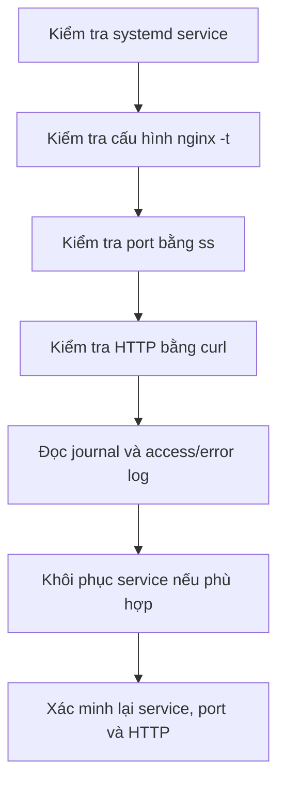

# Triển khai và kiểm tra Nginx

## 1. Mục tiêu

Triển khai một web server trên máy ảo Linux, xác minh service, cổng TCP 80 và phản hồi HTTP, đọc access/error log, sau đó dùng bài lab incident response để thực hành phát hiện và khôi phục service.

> Chỉ dừng/khởi động dịch vụ trong máy ảo lab thuộc quyền quản lý của mình. Không áp dụng lệnh mô phỏng sự cố trên máy production.

## Quy trình kiểm tra sự cố




## 2. Cài đặt và bật dịch vụ

```bash
sudo apt update
sudo apt install nginx curl
sudo systemctl enable --now nginx

systemctl is-active nginx
systemctl is-enabled nginx
```

`systemctl is-active` kiểm tra trạng thái hiện tại; `is-enabled` kiểm tra service có được cấu hình để tự khởi động cùng hệ thống hay không. Kết quả hai lệnh trả lời hai câu hỏi khác nhau.

## 3. Kiểm tra cấu hình, cổng và HTTP

```bash
sudo nginx -t
systemctl is-active nginx
sudo ss -ltnp 'sport = :80'

curl --connect-timeout 2 --max-time 5 \
  -sS -o /dev/null \
  -w 'HTTP status: %{http_code}\n' \
  http://127.0.0.1/
```

Trong kết quả kiểm tra thực tế, `nginx -t` xác nhận cú pháp hợp lệ, Nginx ở trạng thái `active`, cổng 80 lắng nghe trên IPv4/IPv6 và request tới `127.0.0.1` trả HTTP `200`.

### Ảnh Nginx và access log


### Ảnh trạng thái unit và socket lắng nghe


Các ảnh trên cho thấy trạng thái đang hoạt động. Chúng không phải ảnh chụp trong thời gian Nginx bị dừng; xem [báo cáo sự cố](incident-reports/nginx-service-down.md) để đọc dòng thời gian chi tiết.

## 4. Trang web thử nghiệm

Trang thử nghiệm được phục vụ tại `/var/www/html/index.html`. Nội dung hiện tại trong log thực hành có tiêu đề `Linux Server & Network Monitoring Lab` và các dòng mô tả web server đang hoạt động.

Kiểm tra nội dung mà client nhận được:

```bash
curl -sS http://127.0.0.1/ | head -n 12
```

Khi sửa trang, nên lưu một bản sao trước đó hoặc sử dụng bài lab backup/restore trong môi trường thử nghiệm.

## 5. Đọc access log và error log

- Access log: `/var/log/nginx/access.log`
- Error log: `/var/log/nginx/error.log`

```bash
sudo tail -n 20 /var/log/nginx/access.log
sudo tail -n 20 /var/log/nginx/error.log
```

Trong ảnh access log, request `GET /` trả mã `200`; yêu cầu `/favicon.ico` có mã `404`. Mã `404` của favicon thường chỉ cho biết tệp favicon chưa tồn tại tại đường dẫn yêu cầu; cần xét ngữ cảnh trước khi xem nó là lỗi dịch vụ.

## 6. Mô phỏng sự cố Nginx

Bài thực hành đã được thực hiện bằng cách dừng service có chủ đích:

```bash
sudo systemctl stop nginx
systemctl is-active nginx

curl --connect-timeout 2 --max-time 5 \
  -sS -o /dev/null \
  -w 'HTTP status: %{http_code}\n' \
  http://127.0.0.1/

sudo ss -ltnp 'sport = :80'
sudo systemctl status nginx --no-pager -l
sudo journalctl -u nginx --since '10 minutes ago' --no-pager -n 30
```

Kết quả thực tế trong bài lab: service chuyển sang `inactive (dead)`; `curl` không kết nối được, trả HTTP `000` và mã thoát `7`; không còn TCP listener ở cổng 80; journal ghi nhận service được dừng thành công theo yêu cầu.

## 7. Khôi phục và xác minh

```bash
sudo nginx -t
sudo systemctl start nginx
systemctl is-active nginx

curl --connect-timeout 2 --max-time 5 \
  -sS -o /dev/null \
  -w 'HTTP status: %{http_code}\n' \
  http://127.0.0.1/

sudo ss -ltnp 'sport = :80'
./scripts/healthcheck.sh
```

Trong log sau khôi phục: `nginx -t` thành công, service `active`, HTTP trả `200`, socket cổng 80 xuất hiện trở lại. Healthcheck có `0 CRITICAL` và trạng thái tổng thể vẫn `WARNING` do filesystem gốc sử dụng khoảng 82%; cảnh báo disk không đồng nghĩa Nginx còn lỗi.

Báo cáo đầy đủ: [Báo cáo sự cố Nginx Service Down](incident-reports/nginx-service-down.md).

## 8. Những điều cần nhớ

1. `systemctl` kiểm tra trạng thái service nhưng không tự chứng minh client truy cập được.
2. `ss` cho biết có socket lắng nghe tại cổng; `curl` xác minh đường đi tới HTTP endpoint.
3. `journalctl` cung cấp bối cảnh các sự kiện của service.
4. Chạy `nginx -t` trước khi reload cấu hình.
5. Sau khôi phục, cần chạy lại các phép kiểm tra đã thất bại để xác minh kết quả.
