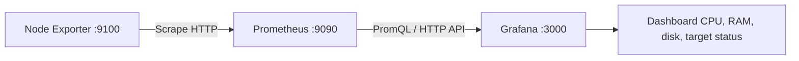

# Giám sát Linux bằng Prometheus, Node Exporter và Grafana

## 1. Mục tiêu

Bổ sung giám sát metrics cho máy Kali Linux trong lab để làm quen với quy trình thu thập dữ liệu, truy vấn và hiển thị trên dashboard.





- **Node Exporter** đọc và xuất các metrics của hệ điều hành Linux.
- **Prometheus** định kỳ thu thập metrics từ endpoint của Node Exporter, lưu dữ liệu chuỗi thời gian và cung cấp API/PromQL.
- **Grafana** kết nối Prometheus làm data source và hiển thị số liệu trên dashboard.

Đây là lab một máy, các thành phần được sử dụng cục bộ. Nó chưa phải thiết kế monitoring production đa máy có phân quyền, cảnh báo, backup và chính sách lưu giữ đã được đánh giá đầy đủ.

## 2. Môi trường đã ghi nhận

| Thành phần | Thông tin |
|---|---|
| Hệ điều hành | Kali GNU/Linux Rolling |
| Môi trường | VMware VM |
| CPU logic | 4 |
| RAM cấp cho VM | 2 GiB trong giai đoạn triển khai monitoring |
| Filesystem gốc | 24 GiB tổng; còn khoảng 6,7 GiB trước khi cài Grafana |
| Prometheus | `3.5.3+ds1-6`, cài từ kho APT của Kali |
| Node Exporter | `1.11.1-3`, cài từ kho APT của Kali |
| Grafana | Đã cài; giao diện đăng nhập/dashboard đã mở; phiên bản cụ thể chưa được ghi lại |

Số liệu RAM/đĩa là snapshot trước khi hoàn tất toàn bộ phần Grafana, không phải trạng thái chính xác hiện tại sau mọi thao tác cài đặt.

## 3. Cài đặt Prometheus và Node Exporter

Các lệnh đã chạy:

```bash
sudo apt update
sudo apt install --no-install-recommends \
  prometheus prometheus-node-exporter
```

APT cho biết sẽ cài ba gói: `prometheus`, `prometheus-node-exporter` và `promtool`; tải xuống khoảng 40,5 MB và cần khoảng 215 MB dung lượng tại thời điểm cài. Không có gói nào bị gỡ trong giao dịch đó.

Sau cài đặt, hai service ban đầu ở trạng thái `inactive (dead)` và chưa tự khởi động. Hai service này sau đó đã được bật và khởi chạy:

```bash
sudo systemctl enable --now prometheus prometheus-node-exporter

systemctl is-active prometheus
systemctl is-active prometheus-node-exporter
```

Kết quả thực tế: cả hai lệnh `is-active` trả về `active`.

## 4. Kiểm tra endpoint

### 4.1. Node Exporter

Node Exporter cung cấp metrics tại cổng `9100`:

```bash
curl -fsS -o /dev/null \
  -w 'HTTP status: %{http_code}\n' \
  http://127.0.0.1:9100/metrics
```

Trong buổi thực hành, `curl http://127.0.0.1:9100/metrics | head` đã in ra các dòng metric như `# HELP`, `# TYPE` và metrics của Go runtime. Vì `head` đóng pipe sau khi đọc đủ dòng, Node Exporter có ghi một số thông báo `broken pipe`; trong bối cảnh lệnh này, đó là tác động của phía đọc đóng kết nối sớm, không tự nó chứng minh exporter bị hỏng. Cách kiểm tra `-o /dev/null` ở trên tránh in toàn bộ metrics và tránh chủ động đóng pipe sớm.

### 4.2. Prometheus

Lệnh đã chạy:

```bash
curl -sS http://127.0.0.1:9090/-/ready
```

Kết quả thực tế:

```text
Prometheus Server is Ready.
```

Điều này xác nhận Prometheus sẵn sàng nhận truy vấn tại thời điểm kiểm tra.

## 5. Cấu hình scrape target

Trong file `/etc/prometheus/prometheus.yml`, thêm job Node Exporter vào `scrape_configs`, đồng thời giữ các job và thiết lập hiện có:

```yaml
scrape_configs:
  # Giữ nguyên các job đã tồn tại trong file thật.
  - job_name: "node"
    static_configs:
      - targets: ["127.0.0.1:9100"]
```

Đoạn trên chỉ minh họa phần cần thêm; không thay toàn bộ file cấu hình nếu nó có các thiết lập khác.

Kiểm tra cấu hình và khởi động lại Prometheus:

```bash
sudo promtool check config /etc/prometheus/prometheus.yml
sudo systemctl restart prometheus
systemctl is-active prometheus
```

Trong phiên đó, mình sao lưu `prometheus.yml` trước khi sửa bằng `cp -a` kèm hậu tố thời gian (`prometheus.yml.bak.$(date +%Y%m%d-%H%M%S)`), sửa bằng nano, rồi chạy `promtool check config` — trả `SUCCESS`, config hợp lệ. Sau `systemctl restart prometheus`, cả hai service trả `active` và readiness endpoint phản hồi `Prometheus Server is Ready`.

Việc cấu hình scrape target và truy vấn metrics đã hoàn tất thành công trong buổi thực hành. Quá trình này có ảnh minh chứng: `images/prometheus_node_check_cpu.png`.

## 6. Truy vấn PromQL

### 6.1. Trạng thái scrape của Node Exporter

```promql
up{job="node"}
```

- `1`: lần scrape gần nhất thành công.
- `0`: lần scrape gần nhất thất bại.

Truy vấn qua API:

```bash
curl -fsSG \
  --data-urlencode 'query=up{job="node"}' \
  http://127.0.0.1:9090/api/v1/query
```

Trong ảnh minh chứng, truy vấn API này trả `status: success` với `value: 1` cho `instance=localhost:9100`, `job="node"` — tức Node Exporter đang được scrape bình thường ở thời điểm đó.

### 6.2. CPU không ở trạng thái nhàn rỗi

```promql
100 * (1 - avg by (instance) (
  rate(node_cpu_seconds_total{job="node", mode="idle"}[5m])
))
```

Công thức tính gần đúng tỷ lệ thời gian CPU không idle trong cửa sổ 5 phút, trung bình trên các CPU logic. Đây là metric theo thời gian, không phải phép đo tức thời.

### 6.3. RAM đã sử dụng theo `MemAvailable`

```promql
100 * (
  1 - (
    node_memory_MemAvailable_bytes{job="node"}
    /
    node_memory_MemTotal_bytes{job="node"}
  )
)
```

Ở lần thử đầu, mình gửi sai định dạng request nên Prometheus trả HTTP 400 và curl thoát mã 22; không phải lỗi dữ liệu. Suy nghĩ lại cú pháp và gửi lại bằng `--get --data-urlencode` thì truy vấn thành công.

Đầu ra JSON thực tế của truy vấn này cho thấy:

- `status`: `success`
- `job`: `node`
- `instance`: `localhost:9100`
- Kết quả tại thời điểm truy vấn: khoảng **74,66%**

Đây là giá trị ở một thời điểm. Không nên tự nó được diễn giải thành sự cố bộ nhớ nếu chưa xem xu hướng, mức RAM khả dụng, swap và các chỉ số khác.


### 6.4. Mức sử dụng filesystem gốc

```promql
100 * (
  1 - (
    node_filesystem_avail_bytes{
      job="node", mountpoint="/", fstype!~"tmpfs|overlay"
    }
    /
    node_filesystem_size_bytes{
      job="node", mountpoint="/", fstype!~"tmpfs|overlay"
    }
  )
)
```

Nếu truy vấn trả về nhiều series, kiểm tra các nhãn `device` và `fstype` để chọn đúng filesystem gốc. Các truy vấn CPU, RAM và disk đã được chạy, nhưng hiện chỉ lưu được giá trị JSON chi tiết cho RAM; không ghi giá trị số CPU/disk khi chưa có đầu ra tương ứng.

## 7. Cấu hình Grafana và dashboard

Grafana đã được cài đặt và giao diện dashboard đã mở. Data source Prometheus được cấu hình để sử dụng Prometheus chạy cùng VM; dashboard được tạo với các panel sau:

| Panel | Truy vấn | Mục đích |
|---|---|---|
| Node Exporter Status | `up{job="node"}` | Hiển thị `1` khi target được scrape thành công và `0` khi scrape thất bại |
| CPU Usage (%) | Công thức CPU ở mục 6.2 | Theo dõi tỷ lệ CPU không idle trong thời gian |
| Memory Usage (%) | Công thức RAM ở mục 6.3 | Theo dõi tỷ lệ RAM đã sử dụng ước tính |
| Root Filesystem Usage (%) | Công thức filesystem ở mục 6.4 | Theo dõi tỷ lệ sử dụng phân vùng `/` |

URL dùng trong lab:

- Prometheus: `http://127.0.0.1:9090`
- Node Exporter metrics: `http://127.0.0.1:9100/metrics`
- Grafana: `http://127.0.0.1:3000`

Các URL loopback dùng được vì tất cả thành phần chạy trên cùng VM. Không mở các cổng này ra mạng ngoài nếu chưa thiết kế kiểm soát truy cập thích hợp. Nếu Grafana vẫn dùng cấu hình mặc định, nên giới hạn `http_addr` về `127.0.0.1` khi chỉ dùng cục bộ và đổi mật khẩu mặc định sau lần đăng nhập đầu tiên.

Khoảng thời gian hiển thị trong ảnh là 6 giờ gần nhất; panel CPU cho thấy load thực tế tăng vọt vài lần trong giờ 17, RAM dao động khoảng 55-80% và disk tăng dần tự nhiên:


**Tình trạng ảnh:** Dashboard Grafana đã có ảnh trong `images/grafana_dashboard.png`; ảnh quá trình kiểm tra Prometheus (promtool, restart, readiness, truy vấn `up`/RAM) có trong `images/prometheus_node_check_cpu.png`. Trang Targets vẫn chưa có ảnh — hãy chụp từ VM thật và thêm vào `images/` theo [checklist bằng chứng](evidence-checklist.md); không tạo ảnh giả để thay thế.

## 8. Kiểm tra và xử lý sự cố

```bash
# Trạng thái dịch vụ
systemctl is-active prometheus
systemctl is-active prometheus-node-exporter
systemctl is-active grafana-server

# Prometheus readiness
curl -fsS http://127.0.0.1:9090/-/ready

# Kiểm tra Node Exporter mà không in toàn bộ metrics
curl -fsS -o /dev/null -w 'HTTP status: %{http_code}\n' \
  http://127.0.0.1:9100/metrics

# Log nếu có lỗi
sudo journalctl -u prometheus -u prometheus-node-exporter -n 50 --no-pager
sudo journalctl -u grafana-server -n 50 --no-pager
```

Nếu `up{job="node"}` không có dữ liệu, kiểm tra job name, cấu hình `scrape_configs`, thời gian scrape và trạng thái target tại `http://127.0.0.1:9090/targets`.

## 9. Giới hạn hiện tại

- Đây là monitoring cục bộ cho một VM, không chứng minh việc giám sát từ xa nhiều server.
- Dashboard đã được tạo xong và có ảnh trong `images/grafana_dashboard.png`; trang Targets vẫn chưa có ảnh.
- Bài mô phỏng Node Exporter dừng/khởi động để xác nhận giá trị `up` chuyển `1 → 0 → 1` chưa có log đầu ra cụ thể; không coi phần này là đã kiểm chứng.
- Chưa mô tả việc thiết lập cảnh báo qua email/chat, SLA, xác thực người dùng tập trung, TLS hay backup của dữ liệu metrics.
- RAM khả dụng của VM khoảng 2 GiB trong giai đoạn triển khai; cần theo dõi bộ nhớ và dung lượng đĩa sau khi Grafana chạy.

## 10. Kết luận

Prometheus và Node Exporter đã được cài từ kho Kali APT, hai service được bật, endpoint metrics/readiness phản hồi, và truy vấn RAM trả về dữ liệu với kết quả khoảng 74,66% tại thời điểm lấy mẫu. Data source Prometheus cũng đã được thêm và dashboard Grafana gồm trạng thái target, CPU, RAM và filesystem đã được tạo, kèm ảnh minh chứng trong `images/`. Bước còn lại là chụp thêm trang Targets và lưu đầu ra cụ thể nếu thực hiện bài test target `UP → DOWN → UP`.
