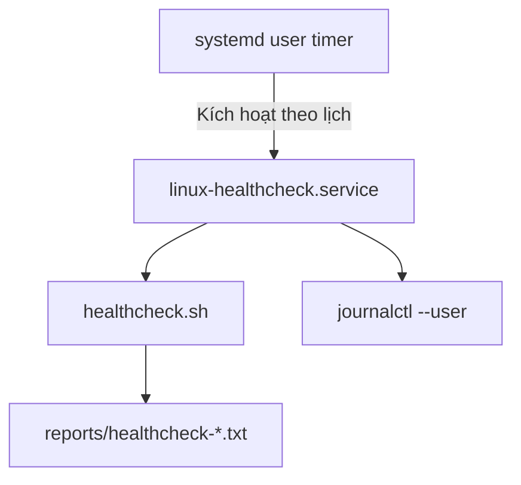

# Tự động chạy healthcheck bằng systemd user timer

## 1. Mục tiêu

Tự động thực thi `scripts/healthcheck.sh` theo lịch thay vì phải chạy thủ công. Bài lab sử dụng `systemd --user`, vì vậy service chạy trong phiên systemd của người dùng hiện tại, không phải một daemon giám sát production chạy độc lập 24/7.

## 2. Các thành phần

- `linux-healthcheck.service`: một tác vụ `Type=oneshot`, chạy script rồi kết thúc.
- `linux-healthcheck.timer`: yêu cầu service chạy khoảng 2 phút sau khi user manager khởi động và sau đó lặp lại khoảng mỗi 30 phút.
- `journalctl --user`: tra cứu log thực thi của service.
- `reports/healthcheck-*.txt`: báo cáo kết quả do script tạo ra.





## 3. Unit file trong repository

Các mẫu unit file được lưu tại:

- [`systemd/user/linux-healthcheck.service.example`](../systemd/user/linux-healthcheck.service.example)
- [`systemd/user/linux-healthcheck.timer`](../systemd/user/linux-healthcheck.timer)

Mẫu service trong repository dùng đường dẫn `~/Desktop/linux-server-monitoring-lab`, khớp với thư mục trong buổi lab này. Nếu clone project ở nơi khác, hãy sửa `WorkingDirectory` và `ExecStart` trong service trước khi cài.

## 4. Cài đặt user service và timer

Từ thư mục gốc project:

```bash
mkdir -p ~/.config/systemd/user

cp systemd/user/linux-healthcheck.service.example \
  ~/.config/systemd/user/linux-healthcheck.service
cp systemd/user/linux-healthcheck.timer \
  ~/.config/systemd/user/linux-healthcheck.timer

systemctl --user daemon-reload
```

Trước khi bật timer, chạy thử service:

```bash
systemctl --user start linux-healthcheck.service
systemctl --user show linux-healthcheck.service \
  -p Result -p ExecMainStatus -p ActiveState
journalctl --user -u linux-healthcheck.service -n 40 --no-pager
ls -lt reports/healthcheck-*.txt | head -n 3
```

Khi service chạy trực tiếp báo `Permission denied` ở bước EXEC, trong lab này đã khắc phục bằng cách cấp quyền thực thi cho script và đổi `ExecStart` để gọi Bash trực tiếp:

```bash
chmod 750 scripts/healthcheck.sh
```

```ini
ExecStart=/usr/bin/bash %h/Desktop/linux-server-monitoring-lab/scripts/healthcheck.sh
```

Cách gọi Bash trực tiếp giúp chạy script ngay cả khi systemd gặp vấn đề thực thi trực tiếp file; các thư mục cha vẫn phải cho phép user đọc/đi vào thư mục và script phải đọc được.

## 5. Bật lịch tự động

```bash
systemctl --user enable --now linux-healthcheck.timer
systemctl --user status linux-healthcheck.timer --no-pager
systemctl --user list-timers --all | grep linux-healthcheck
```

Trong buổi lab, timer hiển thị `Active: active (waiting)` và thời điểm kích hoạt tiếp theo khoảng 30 phút sau lần chạy gần nhất. Nhật ký ban đầu ghi lỗi `203/EXEC` vì quyền thực thi; lỗi này sau đó đã được sửa và cấu hình hoàn tất. Repository hiện chưa kèm ảnh chụp/đầu ra terminal sau khi sửa lỗi, vì vậy nên bổ sung bằng chứng mới trước khi public.

## 6. Diễn giải mã thoát

`healthcheck.sh` trả mã:

- `0`: mọi kiểm tra OK.
- `1`: có WARNING nhưng không có CRITICAL.
- `2`: có CRITICAL hoặc cấu hình đầu vào không hợp lệ.

Unit mẫu khai báo `SuccessExitStatus=1`. Mục đích là xem một lần kiểm tra có cảnh báo nhưng đã chạy xong là tác vụ thực thi hoàn tất; trạng thái hệ thống vẫn phải đọc trong báo cáo. Nếu script trả `2`, service tiếp tục thể hiện thất bại để dễ phát hiện trường hợp nghiêm trọng.

## 7. Dừng hoặc vô hiệu hóa timer

```bash
systemctl --user disable --now linux-healthcheck.timer
```

Để bật lại:

```bash
systemctl --user enable --now linux-healthcheck.timer
```

## 8. Giới hạn

- Đây là user timer: hành vi khi đăng xuất phụ thuộc cấu hình user manager và linger của hệ thống. Không coi cấu hình này là giải pháp giám sát máy chủ 24/7 nếu chưa kiểm tra điều kiện chạy khi không có phiên đăng nhập.
- Một báo cáo được tạo mỗi lần chạy. Nếu timer chạy lâu dài, cần xem xét chính sách giữ/xoay vòng báo cáo để tránh tăng số lượng file không giới hạn.
- `systemd` ghi nhận trạng thái thực thi, còn mức `OK/WARNING/CRITICAL` là nội dung của healthcheck; phải xem cả hai nguồn.
